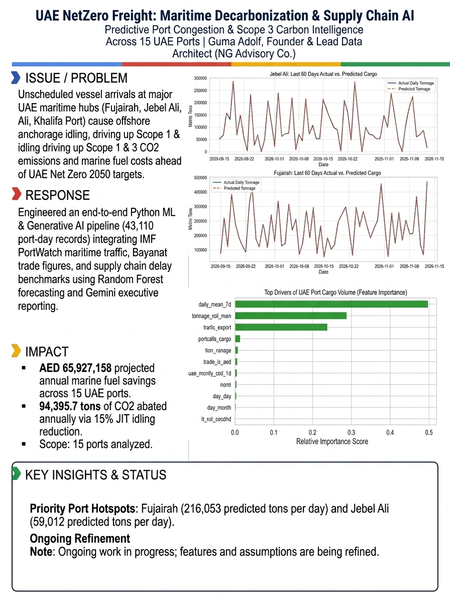

# UAE NetZero Freight: Multi-Source Supply Chain & Maritime Decarbonization Engine

**Author:** Guma Adolf | Founder & Lead Data Architect, NG Advisory Co.  
**Live Interactive App:** [ng-advisory-co.streamlit.app](https://ng-advisory-co.streamlit.app)  
**LinkedIn:** [linkedin.com/in/gumadolf](https://www.linkedin.com/in/gumadolf)  
**Policy Alignment:** UAE Net Zero 2050 Strategy | Federal Decree-Law No. 11/2023 (Carbon Reporting)

---

## Executive Summary

### 1. Key Decarbonization & Fuel Impact
- **JIT Idling Reduction:** 15%
- **Projected Annual CO2 Abated:** 94,395.7 tons
- **Projected Annual Fuel Savings:** AED 65,927,158
- **Scope:** 15 ports analyzed

### 2. Priority Port Hotspots
- **Fujairah:** 216,053 predicted tons per day
- **Jebel Ali:** 59,012 predicted tons per day

### 3. Ongoing Refinement Note
- **Status:** Ongoing work in progress; features and assumptions are being refined.

---

## Data Architecture & Analytical Highlights

This pipeline integrates **43,110 port-day observations** across **15 UAE ports** by combining:
- **IMF PortWatch Maritime Activity:** Daily vessel arrivals (`portcalls`, `portcalls_cargo`) and cargo volumes (`import`, `export`, `total_tonnage`).
- **Bayanat UAE Foreign Trade Data:** Monthly UAE foreign trade benchmarks (`uae_monthly_trade_aed` and `trade_per_call_aed`) aligned to port operations.
- **Supply Chain & Congestion Benchmarks:** Delay and idling multipliers used to model Just-In-Time (JIT) arrival fuel and $\text{CO}_2$ impacts.
- **Out-of-Sample Evaluation & Feature Drivers:** Evaluates 60-day actual vs. predicted cargo tonnage for **Jebel Ali** and **Fujairah** alongside `RandomForestRegressor` feature importances (`tonnage_roll_mean_7d`, `import`, `export`, vessel calls, lag/rolling indicators, calendar features, and trade intensity).

---

## Repository Structure

    uae-netzero-freight-ai/
    ├── UAE_NetZero_Freight.ipynb                  # End-to-end data ingestion, feature engineering, ML modeling & JIT simulation
    ├── UAE_NetZero_Executive_Summary_Report.jpg   # Executive summary visual report
    ├── README.md                                  # Project documentation, summary metrics, and executive conclusion
    └── .gitignore                                 # Excludes local .env credentials and temporary artifacts

---

## Quickstart & Local Setup

1. **Clone the repository:**

       git clone [https://github.com/gumaadolfda-blip/uae-netzero-freight-ai.git](https://github.com/gumaadolfda-blip/uae-netzero-freight-ai.git)
       cd uae-netzero-freight-ai

2. **Install dependencies:**

       pip install pandas numpy matplotlib seaborn scikit-learn openpyxl python-dotenv

3. **Configure environment variables:**
   Create a `.env` file in the root directory (excluded from Git via `.gitignore`) and store required API keys:

       API_KEY=your_api_key_here

4. **Run the notebook:**
   Open `UAE_NetZero_Freight.ipynb` in Jupyter Notebook or VS Code and execute all cells top-to-bottom.

---

## Executive Conclusion & Policy Findings

Integrating historical port and trade records across **43,110 port-day observations** and **15 UAE ports**, the **UAE NetZero Freight** prototype demonstrates how time-series forecasting, classification, and LLM reporting can support port operations and **UAE Net Zero 2050** goals:

### 1. Operational Forecasting & Surge Detection
- **Forecasting Pipeline:** A time-aware `RandomForestRegressor` using leak-free lag and rolling features forecasts daily port cargo tonnage across UAE ports (`train_df` / `test_df` chronological split), alongside a `RandomForestClassifier` early-warning model for high-tonnage surge days.
- **Key Drivers:** Lagged and 7-day rolling tonnage and vessel-call features carry the strongest predictive signal for upcoming port cargo volumes.

### 2. Priority Port Hotspots
- **Top Volume Hubs:** **Fujairah** leads with **216,053 predicted tons/day**, followed by **Jebel Ali** at **59,012 predicted tons/day** in the latest evaluation window.

### 3. Decarbonization & Fuel Scenario Modeling *(Illustrative / Modeled)*
- **Scenario Output:** Under a modeled **15% Just-In-Time (JIT) idling reduction** assumption, the pipeline estimates **94,395.7 tons** of projected annual CO₂ abated and **AED 65,927,158** in projected annual fuel savings.
- **Assumption Basis:** These CO₂ and fuel figures rely on configurable operational and conversion assumptions (`JIT_CO2_FACTOR` and fuel/idling parameters) rather than direct vessel telemetry or audited fuel invoices, and remain a work in progress under active refinement.

### 4. Macro-Economic Context & Executive Automation
- **Trade Benchmarking:** Combining port activity with Bayanat monthly trade benchmarks (`uae_monthly_trade_aed` and `trade_per_call_aed`) links daily port throughput to broader trade volume.
- **Automated Briefings:** Structured model outputs feed a `gemini-3.5-flash-lite` executive brief generator with retry and model-fallback handling for reliable execution.

### Next Steps for Future Iteration
1. **Live Telemetry & Port Integration:** Validate modeled assumptions against real-world vessel arrival/idling data and port workflows.
2. **Intermodal & Rail Context:** Explore how corridor shifts—such as rail connectivity linking ports like Fujairah with inland hubs—affect freight emissions and logistics planning.
